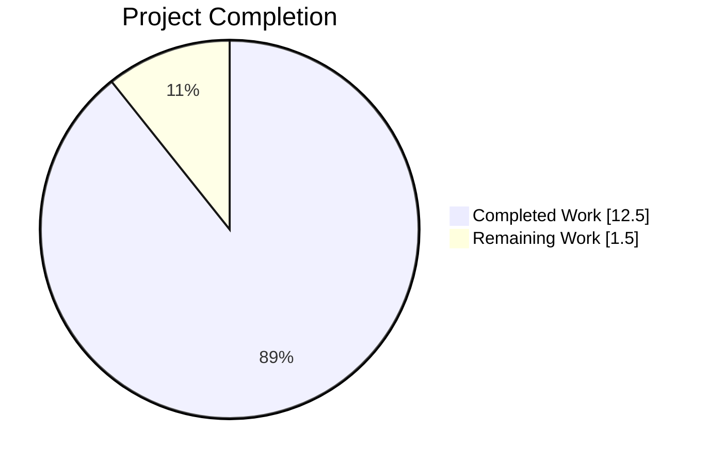
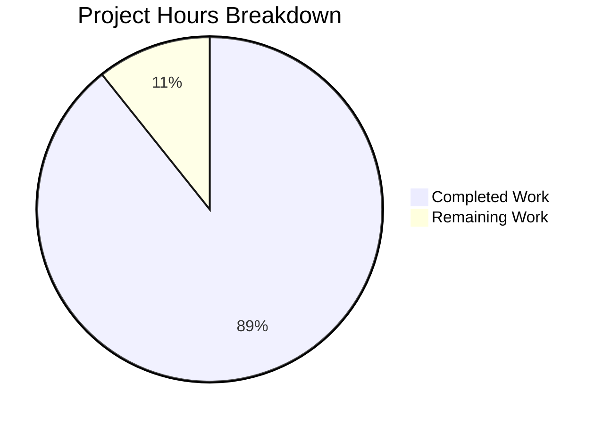

# 1. Executive Summary

## 1.1 Project Overview

Two artefacts and nothing else: `welcome.py` prints `Welcome to Blitzy` to standard output with no formatting, and `hello_world.txt` carries that message as literal content exactly 73,000 times, one per line. There is no manifest, service, build step, configuration or dependency. The audience is the requester and any reviewer checking the pair with ordinary text and hashing tools.

## 1.2 Completion Status

**89.3% complete — 12.5 hours completed of 14.0 total hours, 1.5 hours remaining.** Completion is the plan-scoped ratio `Completed ÷ (Completed + Remaining)` = `12.5 ÷ 14.0`. Every requirement the plan defines is delivered and verified; the rest is path-to-production hardening.



| Metric | Hours |
|---|---|
| Total Hours | 14.0 |
| Completed Hours (AI + Manual) | 12.5 |
| Remaining Hours | 1.5 |

## 1.3 Key Accomplishments

- ✅ The printer emits exactly `Welcome to Blitzy` — 18 bytes on standard output, exit 0, clean standard error (`welcome.py:1`).
- ✅ Minimal source: one line, 27 bytes, one statement, no shebang, import or comment.
- ✅ The content file holds the message exactly 73,000 times, one per line: 1,314,000 bytes, every line the 17-byte unit plus a line feed.
- ✅ One byte-identical unit in both artefacts — printed stream and file line set hash to 2dc7e85a…1951.
- ✅ The file's fixed-content digest is aada5864…3cae, over 73,000 lines.
- ✅ No shipped file generates the 73,000 lines: they exist only as literal committed data.
- ✅ The root holds exactly the two artefacts — no manifest, lockfile, configuration, container, workflow or test suite.
- ✅ Runs on any CPython 3 with no install or shebang, invariant across locales, encodings, interpreters and 20 concurrent runs.

## 1.4 Critical Unresolved Issues

**Both artefacts are delivered with no open defect; 3 open items remain** in the release work around them, all hardening of properties already verified.

| Issue | Impact | Owner | ETA |
|---|---|---|---|
| Release sign-off not yet performed on the merge target | Digests and root composition are confirmed in the delivery environment only | Release reviewer | 0.5h |
| No pin protects line endings on future checkouts | A checkout with CRLF conversion would add exactly 73,000 bytes and break the line count, size and both digests | Build/release owner | 0.5h |
| No automated guard protects the recorded digests from a silent edit | A reformat, whitespace trim or extra line would invalidate the byte contracts unnoticed | Repo maintainer | 0.5h |

## 1.5 Access Issues

No access issues identified. The repository is self-contained — no service, credential or variable is needed — and the credential its remote uses works.

## 1.6 Recommended Next Steps

1. **[High]** Run the verification command set on the merge target and record the digests as the release sign-off (0.5h).
2. **[Medium]** Decide how line endings are protected for future checkouts, then re-confirm counts and digests there (0.5h).
3. **[Medium]** Record the guard for future edits: re-run the command set after any change and review the 1.31 MB file raw (0.5h).
4. **[Low]** Keep `python3 welcome.py` as the documented invocation.

# 2. Project Hours Breakdown

## 2.1 Completed Work Detail

| Component | Hours | Description |
|---|---|---|
| Printer — `welcome.py` | 2.0 | The single-statement source that prints `Welcome to Blitzy`: 1 line, 27 bytes, exit status 0, exactly 18 bytes on standard output, nothing on standard error, no shebang, import, argument handling, logging or error path. Traces to FR1, FR2, FR5 and the stdout contract of AAP 0.3.3, 0.5.4 and 0.7.1. |
| Content artefact — `hello_world.txt` | 2.5 | The fixed literal data file authored once outside the repository and committed verbatim: 73,000 line-feed-terminated lines, each the 17-byte unit, 1,314,000 bytes, digest aada5864…3cae, with no generator behind it. Traces to FR3, FR4 and AAP 0.5.2, 0.5.3 and 0.7.1. |
| Byte contracts, constraint arbitration and footprint discipline | 2.0 | Resolution of the constraint set: the least-lines rule governing the source while the content file carries the fixed count, the printer kept independent of the file so it cannot be the prohibited generator, and every excluded artefact class kept out of the repository. Traces to AAP 0.5.1, 0.5.6, 0.9.2 and 0.13.1–0.13.2. |
| Verification set and runtime matrix | 4.0 | The counting, hashing and byte-comparison gate, plus the exercised matrix: standard-output destinations, locales and encodings, two interpreters, interpreter flags, invocation forms, standard-input variants, repeated and concurrent runs, and side-effect checks. Traces to AAP 0.5.5, 0.10.2 and 0.13.1. Verification is the largest single bloc because proving this deliverable *is* counting and hashing. |
| Repository composition and delivery | 2.0 | Bringing the root to exactly the two artefacts, removing the pre-existing scaffold, confirming the committed blobs are the delivered bytes, and publishing the single delivery commit. Traces to AAP 0.8.1 and 0.10.1. |
| **Total** | **12.5** | Equals the Completed Hours in Section 1.2. |

## 2.2 Remaining Work Detail

| Category | Hours | Priority |
|---|---|---|
| Release verification and digest sign-off on the merge target (path to production) | 0.5 | High |
| Line-ending protection for future checkouts, guarding the byte-exact determinism of the content file (path to production) | 0.5 | Medium |
| Operational guard against silent edits to the content file, protecting its recorded checksum (AAP 0.5.2 data integrity) | 0.5 | Medium |
| **Total** | **1.5** | Equals the Remaining Hours in Section 1.2 and the "Remaining Work" value in Section 7. |

**Hours calculation:** Completed 12.5 + Remaining 1.5 = **Total 14.0 hours**; completion = 12.5 ÷ 14.0 = **89.3%**. No hour in either table falls outside the Agent Action Plan's scope or the standard path to production: no requirement of the plan is outstanding, and no divergence owes work.

## 2.3 Estimation Basis and Confidence

Hours are estimated from the delivered artefacts rather than from a template: the sizes are exactly known (27 bytes of source, 1,314,000 bytes and 73,000 lines of data), the effort blocs follow the plan's own implementation steps — foundation and core logic, testing, and delivery — and the verification bloc is sized by the breadth of the exercised matrix rather than by code volume.

Confidence is **high** for the completed figure, because the delivered work is bounded, measured to the byte and independently reproducible by anyone with the two artefacts. Confidence is **medium** for the remaining figure: the three items are small, well understood, and each closes a risk named in Section 6, but their size depends on organisational choices — where line-ending protection is applied and how the guard is recorded — that are outside the repository.

# 3. Test Results

The delivered behaviour is exercised by a fixed command set in which every assertion carries a literal expected value: counting, hashing and byte comparison are the proof, so no test framework, runner or coverage tool is installed and none is wanted. The table below is what was executed against the delivered artefacts, aggregated by capability.

| Area / Category | Framework | Tests | Passed | Failed | Coverage | What This Proves |
|---|---|---|---|---|---|---|
| Printer behaviour — message, exit status, standard output and error | POSIX shell, coreutils, CPython 3.13.18 | 11 | 11 | 0 | Complete for this behaviour — each property asserted with a literal value; no coverage tooling exists | The program prints `Welcome to Blitzy` unformatted, exits 0, writes exactly 18 bytes to standard output and nothing to standard error |
| Source-footprint contract — `welcome.py` byte shape and absences | coreutils, CPython `ast`, `py_compile` | 16 | 16 | 0 | Complete — every element counted with an expected value | The source is exactly one statement of 27 bytes with no shebang, import, comment, docstring, guard or trailing whitespace, and it compiles clean |
| Content-file volume and byte hygiene — `hello_world.txt` | coreutils (`wc`, `grep`, `awk`, `sort`, `head`, `tail`, `od`), Python re-derivation | 16 | 16 | 0 | Complete — all ten specified properties measured | The file holds 73,000 identical 18-byte lines, 1,314,000 bytes, LF-only with a terminating newline and no byte-order mark, carriage return, blank line or stray byte |
| Repository composition and the no-generator guarantee | coreutils, git plumbing | 11 | 11 | 0 | Complete — the tracked set, the on-disk set and every excluded artefact class checked | The root holds exactly the two artefacts, the committed blobs are the delivered bytes, and no shipped file can produce the content |
| Cross-artefact agreement and side-effect freedom | coreutils (`sha256sum`, `cmp`) | 6 | 6 | 0 | Complete — equality proven by digest, not inferred | The printed unit and the content file's line set are the same bytes, and running the program leaves the content file untouched |
| Determinism and portability — repeats, environments, interpreters, concurrency | coreutils, two CPython 3 interpreters | 12 | 12 | 0 | Complete for the exercised matrix | The same 18-byte stream is produced across repeated and 20 concurrent runs, stripped environments, three locales, an ASCII I/O encoding, eight interpreter flags, an absolute-path invocation from another directory and standard input from a zero device |
| **Total** | — | **72** | **72** | **0** | — | — |

**What the numbers cover.** 72 assertions, 72 passed, 0 failed. No count in this table is a count of files: each row is the number of assertions executed for that capability.

**Not Covered.** Nothing that was delivered is left unexercised — every property the plan specifies is asserted by a command with a literal expected value, and the runtime matrix above covers the program's whole behaviour. Three boundaries are deliberately outside any test and are worth a human's attention before release:

- **Future changes to the artefacts.** No committed test suite, pipeline or attribute guard exists, so nothing detects a reformat, whitespace change or extra line that would invalidate the 27-byte, 73,000-line, 1,314,000-byte and digest contracts. A human should re-run the command set after any change to either artefact.
- **Line-ending behaviour on a different checkout.** The byte contracts are verified on this environment, where no line-ending conversion is configured. A checkout that enables CRLF conversion would add exactly 73,000 bytes; the release owner should re-confirm the line count, size and digests after the first checkout on the target platform.
- **A standard output that cannot be written.** No requirement covers it, so it is not asserted. Writing to an unwritable destination ends with the interpreter's own flush behaviour rather than a defined contract outcome.

No test exists for a browser, page, endpoint or user interface, because the deliverable contains no such surface: its only output is a constant line on standard output, and it binds no port.

# 4. Runtime Validation & UI Verification

The deliverable's entire runtime surface is one process that writes one constant line to standard output, plus a passive text file consumed by ordinary tools. Both were driven directly at runtime.

- ✅ **Program execution from the repository root** — `python3 welcome.py` prints `Welcome to Blitzy`, exit status 0, exactly 18 bytes on standard output, 0 bytes on standard error.
- ✅ **Standard-output destinations** — piped, redirected to a regular file, appended twice (two runs produce exactly 36 bytes in two 18-byte writes) and closed (`>&-` exits 0 with no output and no error).
- ✅ **Standard-input independence** — with input from `/dev/null` and from `/dev/zero` the output is the same 18 bytes, because nothing is ever read.
- ✅ **Invocation forms and working directories** — root-relative, parent-relative, absolute path from another directory, and source fed through standard input all yield the identical stream.
- ✅ **Environment invariance** — a stripped environment, the C locale, a Turkish locale, an ASCII I/O encoding and eight interpreter flags produce the same stream every time; the file is warning-clean under warnings-as-errors.
- ✅ **Interpreter portability** — CPython 3.13.18 and CPython 3.14.4 both emit the byte-identical unit, so the deliverable carries no version dependency.
- ✅ **Concurrency** — 20 simultaneous invocations produced exactly 20 units (360 bytes, one distinct line) with no interleaving, truncation or standard-error output.
- ✅ **Side-effect freedom** — repeated runs leave the content file's digest, size and timestamps unchanged and create no bytecode cache in the repository.
- ✅ **Content-file consumption by text tools** — `wc`, `grep`, `awk`, `sort`, `head`, `tail`, `od` and `sha256sum` all return the expected values against the 1.31 MB file, including its anchored occurrence count and its unit digest.
- ✅ **Repository composition at runtime** — after every command, the working tree is still exactly the two artefacts with no untracked, ignored or generated residue.

**Never exercised at runtime.** No browser-driven flow was run, and none can be: the repository contains no HTML, JavaScript, CSS, page, route or endpoint, the program binds no port and starts no background process, and nothing in the tree makes an outbound call. There is therefore no user interface, no API surface, no authentication or session behaviour, no database, queue or cache operation, and no external integration to drive — all of which the deliverable's scope excludes rather than omits. The one behaviour observed but deliberately outside any contract is writing to an unwritable destination, where the run ends with the interpreter's own flush behaviour instead of a defined outcome.

# 5. Compliance & Quality Review

## 5.1 Compliance Matrix

Each row maps a delivered capability to the quality and compliance benchmark it must meet, with its verified status as it stands now.

| # | Deliverable / Capability | Benchmark | Status | Progress | Evidence |
|---|---|---|---|---|---|
| 1 | Printer output — exactly `Welcome to Blitzy`, unformatted | Functional requirement: no label, quotes, numbering, separator, colour or markup; nothing on standard error | ✅ Pass | 100% | `welcome.py:1`; 18 stdout bytes, 0 stderr bytes, exit 0; hex dump ends `79 0a` |
| 2 | Source minimality — fewest lines, leanest tokens | Functional requirement: 1 line / 27 bytes, one statement, no shebang, import, comment, docstring or guard | ✅ Pass | 100% | `welcome.py:1`; 27 bytes, digest 79ad31b9…6360, one AST statement, compiles clean |
| 3 | Content volume — the message exactly 73,000 times, one per line | Functional requirement: anchored count 73,000 over whole lines | ✅ Pass | 100% | `hello_world.txt:1-73000`; 73,000 lines, 73,000 anchored matches, 1 distinct line |
| 4 | No generator — the lines exist only as literal content | Functional requirement: no shipped script, loop, template or helper produces them | ✅ Pass | 100% | No file references the content path; no generator-class file in the tree or in either commit; five runs leave the file byte-identical |
| 5 | Names, casing and root composition | Functional requirement: exact lower-case names, exact casing, root holding only the two artefacts | ✅ Pass | 100% | Tracked set and on-disk set are exactly `hello_world.txt` and `welcome.py` |
| 6 | Byte-exact determinism and data integrity | Non-functional: ASCII, LF only, terminating newline, no BOM, CR, blank line or trailing space; 18 bytes per line; 1,314,000 bytes; fixed digest | ✅ Pass | 100% | Byte identity to 73,000 units; digest aada5864…3cae; committed blob identical to the working file |
| 7 | Minimal footprint | Non-functional: exactly two files; no manifest, lockfile, container, workflow, test suite, generator or configuration | ✅ Pass | 100% | 2 files at any depth; every excluded class verified absent; no cache, backup or ignored file |
| 8 | Zero runtime dependencies and portability | Non-functional: only the language builtin; runs on any CPython 3 with no install, virtual environment or shebang | ✅ Pass | 100% | 0 imports; identical output on both available interpreters, stripped environment, three locales, eight flag forms |
| 9 | Verifiability | Non-functional: every delivered property provable by counting, hashing or byte comparison | ✅ Pass | 100% | 72 assertions with literal expected values; both digests re-derivable in one command each |
| 10 | Security posture | Non-functional: no control required — the entire external surface is a constant string on stdout | ✅ Pass | 100% | No input, argument, environment read, file write, network call or credential; no injection sink; no dependency to supply |
| 11 | Language style and conventions | Style: conventional module name, double-quoted literal, LF-terminated file, no trailing whitespace or tab, no formatter or style file added | ✅ Pass | 100% | `welcome.py:1` byte shape; no style configuration exists |
| 12 | Change discipline and scope exclusions | Scope: no file the request does not name added, restructured or renamed; the work stops when the artefacts exist | ✅ Pass | 100% | Single delivery commit changing exactly three paths; no artefact beyond the two exists |

## 5.2 AAP & Rule Divergences and Gaps

Four divergences were established. All four are departures from what was agreed rather than defects, all four are deliberate, and **none blocks release or requires implementation work** — so none is carried into Section 2.2, whose 1.5 hours are path-to-production hardening independent of them. No rule divergence exists or can exist: this project was delivered with **no user-specified rules** to follow, so every requirement that binds it comes from the plan itself, and the four departures below are departures from that plan's wording.

| # | What the AAP/Rule Required | What Was Delivered Instead | Why It Diverged | Impact | Remediation |
|---|---|---|---|---|---|
| D1 | "Both entries are CREATE. Nothing is updated or deleted, because the checkout is empty and no existing file is touched." | The repository's one pre-existing tracked file, a 39-byte two-line scaffold, was deleted in the single delivery commit, leaving the root holding only the two artefacts (`hello_world.txt`, `welcome.py`) | The premise was false: the checkout was a git repository whose only tracked file was that scaffold. Higher statements inside the same plan require its removal — the structure section specifies a two-file root, the scope section excludes documentation artefacts, the functional requirement states the root contains only the two files, and the plan's own root-contents verification depends on it — and the user's instruction not to deviate from the constraints leaves no room for an unrequested file | None on correctness: the delivered root is exactly what the plan's verification demands. A reader comparing the plan's sentence with the tree must be told, or they may mistake the deletion for an unplanned change | None needed. Restoring the file would break the two-file root, the scope exclusion and the root-contents verification |
| D2 | Validation and delivery with the interpreter named in the plan's environment section, `/usr/bin/python3` (described there as CPython 3.12.3) | Every run and check used `python3` from `PATH`, CPython 3.13.18 | The environment's own instructions name that interpreter as the one to use and warn that the other interpreter on this host is 3.14.4 and writes its site-initialisation text to standard error on every invocation, which would falsify the "nothing on standard error" contract. The plan itself sets the runtime floor only as "CPython 3" with no version pin, and the environment instruction outranks the plan's note | None: both interpreters emit the byte-identical 18-byte stream and digest 2dc7e85a…1951, so the contract was verified under both | None needed. Record the two interpreters in your own environment notes if your gate asserts a clean standard error; on 3.14.4 prefix `SETUPTOOLS_USE_DISTUTILS=stdlib` |
| D3 | "a single space around the call" in the language-conventions section | The delivered source is `print("Welcome to Blitzy")` — no space before the parenthesis — at exactly 1 line and 27 bytes | The plan contradicts itself: its byte-exact specification fixes the content as `print("Welcome to Blitzy")` at 27 bytes on one line, and its verification asserts the printed stream's digest. A space would make the file 28 bytes and break the 27-byte contract, the stdout digest and the convention's own "as less lines as possible" requirement, so the specific, verifiable statement governs | None on the delivered bytes | None needed — and this is the one remedy to avoid: a later editor "correcting" the spacing would break the byte contract and both digests (`welcome.py:1`) |
| D4 | The plan's descriptive prose: an empty, non-git checkout at a stated path, and a runtime of CPython 3.12.3 at `/usr/bin/python3` | A git repository holding the two artefacts plus the deleted scaffold; CPython 3.13.18 on `PATH` and 3.14.4 at that path | Plan-authoring environment text that changed before delivery; no delivered value depends on it, since the artefacts are interpreter-independent and the delivered root composition is what the plan's verification requires | None on the artefacts; it can mislead a reader into expecting an empty checkout or a different interpreter, and away from the interpreter that keeps standard error clean | None in the repository. Treat those sentences as plan-authoring context and read the delivered tree as authoritative |

**D1 — the scaffold deletion, in detail.** The plan's file-creation table lists two files to create and asserts that nothing is deleted, on the stated premise that the checkout is empty. The checkout was not empty: its base commit's tree was a single 39-byte file consisting of one markdown heading and one provenance line. Keeping it would have left a third root entry, contradicting the functional requirement that the root contains only the two artefacts and the plan's own root-contents verification, and it would have added an unrequested documentation artefact to a scope that excludes documentation. Removing it was therefore the only delivery that satisfies the plan's verified requirements. The evidence a reader can open: the current root (`git ls-files` = `hello_world.txt`, `welcome.py`), the delivery commit's three-path change set, and the scaffold's own content in the base commit. The decision a human must take is simply to accept it — the alternative, restoring the file, would fail three requirements.

**D2 — the interpreter choice, in detail.** The plan names `/usr/bin/python3` as the verified interpreter, quoting a version this host does not have. The delivered and validated runs used `python3` from `PATH` (CPython 3.13.18) because the environment's own instruction names it as the interpreter to use and warns that the alternative writes 297 bytes of its site-initialisation text to standard error on every invocation. That text would falsify the "nothing written to standard error" contract on any run that used it, and it originates in the interpreter rather than in `welcome.py:1`, which writes zero bytes to standard error under every configuration tried. Both interpreters were exercised and both produce the identical 18-byte unit and digest. The decision for a human is documentary: record which interpreter your own verification gate must use, and note that on the 3.14 interpreter a clean standard error requires `SETUPTOOLS_USE_DISTUTILS=stdlib`.

**D3 — the spacing phrase, in detail.** One sentence of the plan's style guidance asks for "a single space around the call"; the same plan's byte-exact specification fixes `print("Welcome to Blitzy")` at exactly 1 line and 27 bytes, and its verification asserts the digest of the printed 18-byte stream. The two cannot both hold: adding a space produces a 28-byte file and, with it, a different source digest while the printed stream stays the same only by accident of the call form. The delivered form follows the byte-exact specification, which is the more specific and the externally verifiable statement. The decision for a human is again to leave it alone: the file's byte contract and both digests depend on the absence of that space.

**D4 — the stale descriptive prose, in detail.** The plan describes an empty checkout that is not a git repository, at a path that does not exist on this host, and a runtime of CPython 3.12.3 at `/usr/bin/python3`. The repository is a git repository holding the two artefacts, and its history records the scaffold removal; the interpreters present are 3.13.18 on `PATH` and 3.14.4 at that path. No delivered value depends on any of it — the artefacts are byte-identical regardless of interpreter — but a reader who trusts the prose rather than the repository may conclude that nothing was deleted or look for the wrong directory. No repository change can settle it, and none is needed: the tree, the digests and the delivery commit are the authoritative statement of what shipped.

# 6. Risk Assessment

Risks here are forward-looking — what could still go wrong once this is in use. Nothing in this table is an issue that was raised and corrected; the deliverable's own behaviour is verified and carries no residual defect.

| Risk | Category | Severity | Probability | Mitigation | Status |
|---|---|---|---|---|---|
| A future edit to either artefact — a reformat, a whitespace trim or an added line — silently invalidates the 27-byte source contract, the 73,000-line count, the 1,314,000-byte size and both digests, because nothing automated guards them | Technical | Medium | Medium | Re-run the recorded command set after any change and re-record the two digests; treat the digests as the contract | Open — accepted by design; remaining-work item |
| A checkout that enables CRLF conversion adds exactly 73,000 bytes to the content file, breaking the line count, the size and both digests | Technical / Operational | High | Low | Keep line-ending conversion disabled for clones of this repository, or pin it outside the repository, then re-confirm the counts and digests after the first checkout on the target platform | Open — monitored; remaining-work item |
| The 1.31 MB content file renders as a large-file stub rather than a diff in review tooling, so a change to it could be merged unseen | Operational | Medium | High | Inspect the file raw and confirm both digests rather than relying on a rendered diff | Open — accepted by design; remaining-work item |
| The content is immutable literal data with no shipped producer, so correcting it means re-authoring it once outside the repository and re-recording its digests | Operational | Medium | Low | Use the documented authoring recipe; a defect in the file is re-authored, never generated by shipped code | Open — accepted by design |
| Running the module by import rather than by path leaves a bytecode cache at the repository root, adding an entry to a raw directory listing | Operational | Low | Medium | Use the documented invocation `python3 welcome.py`, which leaves the tree clean | Open — accepted by design |
| The second interpreter on this host writes its own site-initialisation text to standard error on every invocation, which can be misread as a defect by anything asserting a clean standard error | Operational | Low | Medium | Run with the interpreter the delivered invocation uses, or prefix `SETUPTOOLS_USE_DISTUTILS=stdlib`; the program itself writes zero bytes to standard error | Open — environmental |
| Release sign-off has not yet been performed on the merge target, so the digests and root composition are confirmed in the delivery environment only | Operational / Process | Low | Medium | Re-run the command set on the merge target and record the outputs as the sign-off | Open — remaining-work item |
| No residual security, supply-chain or integration risk exists: the program's entire external surface is a compile-time constant on standard output, with no input, argument, environment read, file write, network call or credential; it declares no dependency; and the two artefacts share only the message text, with no call edge, contract or consumer | Security / Integration | Low | Low | None required — the absence of controls is a deliberate decision for this surface | Closed by construction |

# 7. Visual Project Status

Project hours split between delivered work and what remains:



**Chart legend:** Completed Work = Dark Blue (#5B39F3); Remaining Work = White (#FFFFFF).

Remaining hours by category (from Section 2.2):

| Remaining Category | Hours | Share of Remaining |
|---|---|---|
| Release verification and digest sign-off | 0.5 | 33.3% |
| Line-ending protection for future checkouts | 0.5 | 33.3% |
| Operational guard against silent edits | 0.5 | 33.3% |
| **Total** | **1.5** | **100%** |

Priority distribution of the remaining work: **1 High** (0.5h — release sign-off), **2 Medium** (1.0h — line-ending protection and the edit guard), **0 Low**. There is no low-priority or optional work outstanding.

Delivered capabilities by verification status: **12 of 12 compliance areas pass** (Section 5.1), **72 of 72 executed assertions pass** (Section 3), and **1.5 of 14.0 hours remain**, giving **89.3% complete**.

# 8. Summary & Recommendations

**What was delivered and verified.** A two-artefact, zero-dependency result: `welcome.py`, one statement that prints `Welcome to Blitzy` unformatted — exit status 0, exactly 18 bytes on standard output, nothing on standard error — and `hello_world.txt`, the same message as literal content exactly 73,000 times, one occurrence per line, at 1,314,000 bytes with every line the identical 17-byte unit plus a line feed. The two artefacts share one byte-identical unit, proven by digest rather than by reading: the printed stream, the file's collapsed line set and a reference construction of the unit all hash to 2dc7e85a…1951, and the file's own digest is aada5864…3cae. The root holds exactly those two files. Every property was exercised against a literal expected value — 72 assertions covering the program's stdout contract, the source's byte shape and absences, the content file's volume and byte hygiene, repository composition, cross-artefact equality and side-effect freedom, and the program's invariance across repeats, locales, encodings, interpreters, flags, invocation forms, standard-input variants and 20 concurrent runs. All 72 passed.

**What the plan required and what is left.** Every functional and non-functional requirement the plan defines is delivered and verified: the unformatted message, the least-lines source at 27 bytes, the exact 73,000-occurrence count, the prohibition on any generating script, the exact names and casing, byte-exact determinism, a two-file footprint with no manifest, lockfile, container, workflow, test suite or configuration, zero runtime dependencies and portability across CPython 3, verifiability by counting and hashing, and the deliberately absent security surface. That puts the project at **89.3% complete — 12.5 hours of 14.0 hours delivered, 1.5 hours remaining**. The remaining 1.5 hours are not deliverable gaps; they are path-to-production hardening of properties that are already verified: signing off the digests on the merge target, protecting the byte contracts from line-ending conversion on future checkouts, and agreeing the guard that catches a silent future edit to the fixed-content file.

**Divergences you should know about.** Four departures from the plan's wording are recorded in Section 5.2, none of them a defect and none needing implementation work. The one that changes what shipped is the removal of a 39-byte pre-existing scaffold: the plan asserted that nothing would be deleted because the checkout was empty, but the checkout held that file, and keeping it would have contradicted the plan's own requirement that the root contains only the two artefacts. The second is the use of the interpreter that keeps standard error clean rather than the one the plan's environment note names — both produce the identical byte stream. The third is a self-contradiction inside the plan's style guidance, settled in favour of its byte-exact specification: do not "fix" the missing space before the parenthesis, because the 27-byte contract and the 32-hex-digit digests depend on it. The fourth is stale descriptive prose about the checkout and the interpreter version, which no repository change can settle and which nothing delivered depends on.

**Critical path to production.** Three steps, 1.5 hours in total. First, re-run the verification command set on the merge target and record the two digests and the root composition as the release sign-off (0.5h, High). Second, decide and apply how line endings are protected for anyone who checks the repository out, then re-confirm the content file's line count, size and digests after the first checkout on the target platform (0.5h, Medium). Third, record the operational guard for future edits — any change to either artefact is followed by a re-run of the command set and re-recording of the digests, and reviews of the 1.31 MB file inspect it raw (0.5h, Medium). Nothing else stands between this repository and release.

**Production readiness assessment: ready, for the purpose it was built for.** The deliverable is deterministic and byte-exact, has no runtime dependency to supply, no environment variable or configuration to set, no service to start and no build step to run. Its residual risks are environmental rather than functional, and all three that remain open are the ones listed above as remaining work: nothing automated guards the frozen byte contracts, line endings are not pinned outside the repository, and the sign-off has not happened on the merge target. Success for this project is not a throughput or availability metric; it is that the printed message and the 73,000-line file stay byte-identical to their recorded digests, which the counts and hashes in Section 3 and Section 9 let anyone confirm in under a minute.

# 9. Development Guide

## 9.1 System Prerequisites

- A POSIX shell with the standard core utilities: `wc`, `sort`, `grep`, `awk`, `head`, `tail`, `od`, `cmp`, `tr`, `sha256sum`.
- CPython 3, invoked as `python3`. The delivered and validated interpreter is CPython 3.13.18; the single-statement source is version-agnostic across CPython 3 and also produces the identical output on CPython 3.14.4.
- Git, to clone the repository and to inspect its composition.
- Nothing else. No package manager step, no build tool, no container runtime, no database and no service.

## 9.2 Environment Setup

```bash
git clone <repository-url> 73k-lines
cd 73k-lines
git ls-files
```

Expected `git ls-files` output — exactly two paths, and nothing else:

```text
hello_world.txt
welcome.py
```

There is no dependency installation step, no virtual environment to create, no environment variable to export, no configuration file to edit and no secret to supply. The repository is complete as cloned.

## 9.3 Running the Program

From the repository root:

```bash
python3 welcome.py
```

Expected output, and nothing more:

```text
Welcome to Blitzy
```

## 9.4 Verification Steps

Run these from the repository root. Each command is copy-pasteable, and the expected output beside it is the value observed when this deliverable was verified.

```bash
# Exit status, standard-output size, and the digest of the printed stream
python3 welcome.py; echo "exit=$?"
python3 welcome.py | wc -c                 # 18
python3 welcome.py | sha256sum             # 2dc7e85a734de043468d7beb8ee5294e0c04440f23fd89b69fd8ea0ee7971951  -
python3 welcome.py 2>/dev/null | od -c     # W e l c o m e   t o   B l i t z y \n  (18 bytes, no BOM, no escapes)

# Content file: volume, size and fixed-content digest
wc -l < hello_world.txt                    # 73000
wc -c < hello_world.txt                    # 1314000
sha256sum hello_world.txt                  # aada5864a6c8b9d66f96460cecfe9b8c1dcdef066ae4386ed70489c9ceaf3cae  hello_world.txt

# Content file: every line is the same unit
grep -c '^Welcome to Blitzy$' hello_world.txt   # 73000
awk 'length($0) != 17' hello_world.txt | wc -l  # 0
sort -u hello_world.txt | sha256sum             # 2dc7e85a…1951  -   (the printed stream's digest)
head -c 3 hello_world.txt                       # Wel             (no byte-order mark)
tail -c 18 hello_world.txt | od -c              # the unit plus \n, closing at offset 0000022
```

A passing run means: the printed stream and the file's line set are the same 18 bytes, the file holds exactly 73,000 of them, and the repository contains nothing that could have produced them.

## 9.5 Example Usage

Print the message and confirm it is the file's unit, in two commands:

```bash
python3 welcome.py | sha256sum
sort -u hello_world.txt | sha256sum
```

Both print the same digest, `2dc7e85a734de043468d7beb8ee5294e0c04440f23fd89b69fd8ea0ee7971951`. Two more one-liners exercise the deliverable without opening the 1.31 MB content file:

```bash
python3 welcome.py | od -c                            # the 18-byte stream, byte by byte
grep -o 'Welcome to Blitzy' hello_world.txt | wc -l   # 73000
```

The second command counts occurrences independently of the line structure, so it also proves the file holds no line carrying the message twice.

## 9.6 Re-authoring the Content File

`hello_world.txt` is fixed literal content with no generator behind it, so it is never regenerated by shipped code. If it must ever be re-created, run this once from a directory **outside** the repository and replace the file with the result, then re-verify the counts, the size and the digests above:

```bash
yes 'Welcome to Blitzy' | head -n 73000 > hello_world.txt
```

The non-zero exit status you may see from the producer is expected and harmless: the reader stops after 73,000 lines, which closes the pipe. Do not wrap this command in a pipeline that fails on that signal. The result is 73,000 lines, 1,314,000 bytes and digest aada5864a6c8b9d66f96460cecfe9b8c1dcdef066ae4386ed70489c9ceaf3cae — byte-identical to the delivered file.

## 9.7 Troubleshooting

| Symptom | Cause | Resolution |
|---|---|---|
| `./welcome.py` fails with permission denied or a shell syntax error | The file is mode 644 with no shebang, by design | Invoke it as `python3 welcome.py`; neither an executable bit nor a shebang is needed |
| A raw standard-error capture shows text bytes | The second interpreter on this host (`/usr/bin/python3`, 3.14.4) writes its own site-initialisation message on every invocation | Run with `python3` from `PATH`, which the delivered invocation uses; on the 3.14 interpreter prefix `SETUPTOOLS_USE_DISTUTILS=stdlib`. The program itself writes zero bytes to standard error |
| A `__pycache__` directory appears at the root | The program was run by module import rather than by path | Use `python3 welcome.py`. Nothing tracked changes either way, and nothing in the repository references the cache |
| The content file appears as a large-file stub instead of a diff | 1.31 MB and 73,000 lines exceed the limits of inline diff rendering | Inspect the raw file and compare the two digests; they are the compact, re-derivable proof |
| `wc -l` reports 72999, or the byte count drifts from 1314000 | The final newline is missing, or line endings changed — a checkout with CRLF conversion adds exactly 73,000 bytes | Keep line-ending conversion disabled for clones, and restore the file with the recipe in 9.6 |
| `grep -E` with `\t` matches the letter `t` instead of a tab | Backslash escapes are not portable across `grep` implementations | Use `grep -F` with a literal tab, or `tr -cd '\t' \| wc -c`, when auditing for tab characters |
| The content file is missing or altered | It is literal data, not generated output | Re-create it with the recipe in 9.6 and re-record the digests; never add a generator to the repository |

# 10. Appendices

## Appendix A — Command Reference

All commands are run from the repository root.

| Command | Purpose | Expected output |
|---|---|---|
| `python3 welcome.py` | Print the message | `Welcome to Blitzy`, exit status 0 |
| `python3 welcome.py \| wc -c` | Size of the printed stream | `18` |
| `python3 welcome.py \| sha256sum` | Digest of the printed stream | `2dc7e85a734de043468d7beb8ee5294e0c04440f23fd89b69fd8ea0ee7971951` |
| `python3 welcome.py 2>/dev/null \| od -c` | Byte-level view of the output | `W e l c o m e   t o   B l i t z y \n` at offsets 0000000–0000022 |
| `wc -l < hello_world.txt` | Line count of the content file | `73000` |
| `wc -c < hello_world.txt` | Byte count of the content file | `1314000` |
| `sha256sum hello_world.txt` | Fixed-content digest | `aada5864a6c8b9d66f96460cecfe9b8c1dcdef066ae4386ed70489c9ceaf3cae` |
| `grep -c '^Welcome to Blitzy$' hello_world.txt` | Exact per-line occurrence count | `73000` |
| `grep -o 'Welcome to Blitzy' hello_world.txt \| wc -l` | Occurrence count independent of line structure | `73000` |
| `awk 'length($0) != 17' hello_world.txt \| wc -l` | Lines that are not the 17-byte unit | `0` |
| `sort -u hello_world.txt \| wc -l` | Distinct lines | `1` |
| `sort -u hello_world.txt \| sha256sum` | Digest of the collapsed line set | the same unit digest as the printed stream |
| `head -c 3 hello_world.txt` | First three bytes | `Wel` — no byte-order mark |
| `tail -c 18 hello_world.txt \| od -c` | Final line and its terminator | the unit plus `\n`, closing at 0000022 |
| `git ls-files` | The delivered file set | `hello_world.txt`, `welcome.py` |
| `git log --oneline -1` | The delivery commit | `eba177d Add welcome.py printer and hello_world.txt content, drop README.md scaffold` |
| `yes 'Welcome to Blitzy' \| head -n 73000 > <file outside the repo>` | Re-author the content file (see 9.6) | 73,000 lines / 1,314,000 bytes / digest aada5864…3cae |

## Appendix B — Port Reference

No ports. The program binds no socket and serves nothing: its only output surface is a standard-output stream, and it starts no background process. Nothing in the repository listens on a port, and no port configuration exists.

## Appendix C — Key File Locations

| Path | Role |
|---|---|
| `welcome.py` | The printer: one statement, 27 bytes, the only source file. Digest 79ad31b9300525e855715722c82219fde4642214f5501577534dc40b569b6360 |
| `hello_world.txt` | The content artefact: 73,000 lines, 1,314,000 bytes, fixed literal data. Digest aada5864a6c8b9d66f96460cecfe9b8c1dcdef066ae4386ed70489c9ceaf3cae |
| `.git/` | Repository metadata — not a deliverable, and excluded from every inventory and count |

No other path exists in the delivered tree: no source directory, test directory, documentation tree, configuration directory, manifest or workflow file.

## Appendix D — Technology Versions

| Component | Version observed |
|---|---|
| Python (invoked as `python3`, `/usr/local/bin/python3`) | CPython 3.13.18 |
| Python (`/usr/bin/python3`) | CPython 3.14.4 |
| Git | 2.56.0 |
| `wc` | 0.10.0 |
| `sha256sum` | 0.10.0 |
| `sort` | 0.10.0 |
| `head`, `od` | 0.10.0 |
| `grep` | GNU grep 3.12 |
| `awk` | mawk 1.3.4 |
| Shell | GNU bash 5.3.9 |
| Operating system | Ubuntu 26.04.1 LTS |

The source uses no version-pinned facility, so the interpreter line is informative rather than a requirement; the identical 18-byte stream and digest were produced under both interpreters listed.

## Appendix E — Environment Variable Reference

None. The deliverable reads no environment variable, and no variable, secret or credential is required to build, run or verify it. For completeness, two interpreter-level settings can be useful when a verification gate asserts a clean standard error or a clean tree:

| Variable | Effect |
|---|---|
| `SETUPTOOLS_USE_DISTUTILS=stdlib` | Silences the site-initialisation text written to standard error by the 3.14 interpreter; the printed stream is unchanged |
| `PYTHONDONTWRITEBYTECODE=1` | Prevents a bytecode cache if the source is ever run by module import rather than by path |

## Appendix F — Developer Tools Guide

| Task | Command |
|---|---|
| Confirm the byte contracts after any edit | Re-run every command in Appendix A and compare with the expected output |
| Read the content file without loading it into an editor | `head -n 3 hello_world.txt`, `sed -n '1p;73000p' hello_world.txt`, `sort -u hello_world.txt \| sha256sum` |
| Confirm the committed bytes are the delivered bytes | `git status --porcelain -uall` (empty) and `git hash-object hello_world.txt` equal to `git rev-parse HEAD:hello_world.txt` |
| Confirm nothing else was added to the repository | `git ls-files` and a full-depth file listing; both must show exactly the two artefacts |
| Confirm the program has no side effects | Hash the content file, run the program, hash it again — the digests and timestamps must be identical |
| Confirm portability of the output | Run under `env -i`, under `LC_ALL=C`, and under both interpreters, comparing the digest each time |

Two conventions this repository depends on: line endings must stay LF (a checkout with CRLF conversion adds exactly 73,000 bytes), and reviews of the 1.31 MB content file use its digests rather than a rendered diff.

## Appendix G — Glossary

- **Unit** — the 17-byte ASCII string `Welcome to Blitzy`; with its line feed it is 18 bytes, which is exactly what the program prints.
- **Content artefact** — `hello_world.txt`, fixed literal data holding the unit once per line, 73,000 times.
- **Printer** — `welcome.py`, the one-statement program that writes the unit to standard output.
- **Byte-exact determinism** — the property that both artefacts are fixed at the byte level: 27 bytes of source; 1,314,000 bytes, 73,000 lines and two recorded digests of content, invariant across environments and runs.
- **Anchored count** — a count of lines matching the unit exactly from start to end of line, which proves nothing was prefixed, suffixed or wrapped.
- **Fixed-content digest** — the SHA-256 value of the whole content file, aada5864…3cae; any byte change invalidates it.
- **Unit digest** — the SHA-256 value of one 18-byte unit, 2dc7e85a…1951, which the printed stream and the file's collapsed line set both produce.
- **Tracked set** — the paths git records at the repository's current commit; here exactly the two artefacts.
- **Authoring recipe** — the one-off streaming command used to produce the content file outside the repository; it is deliberately not part of the delivered repository.
